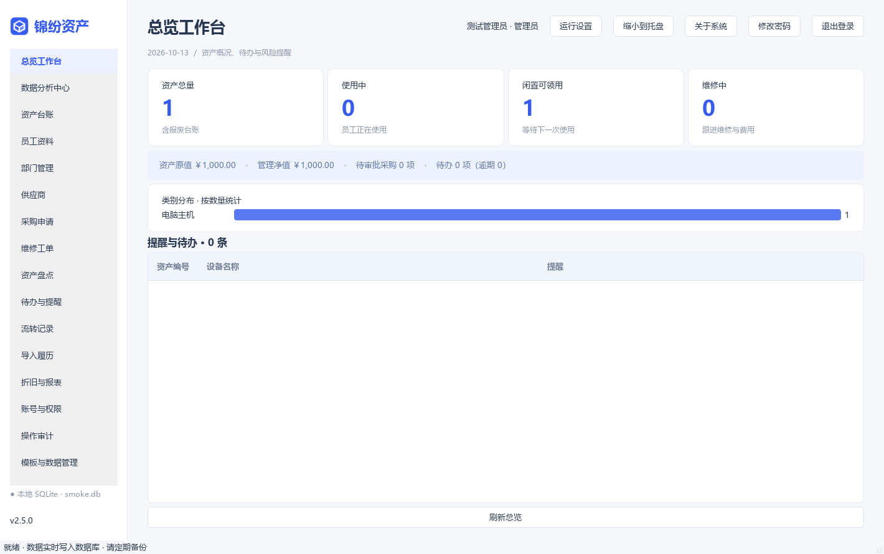
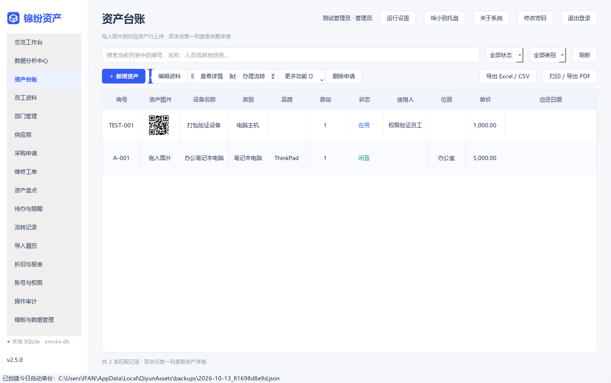
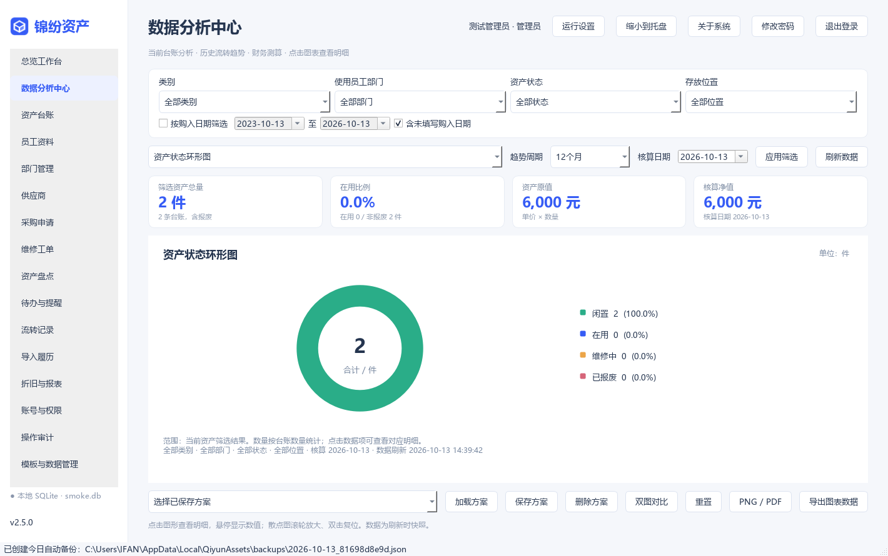
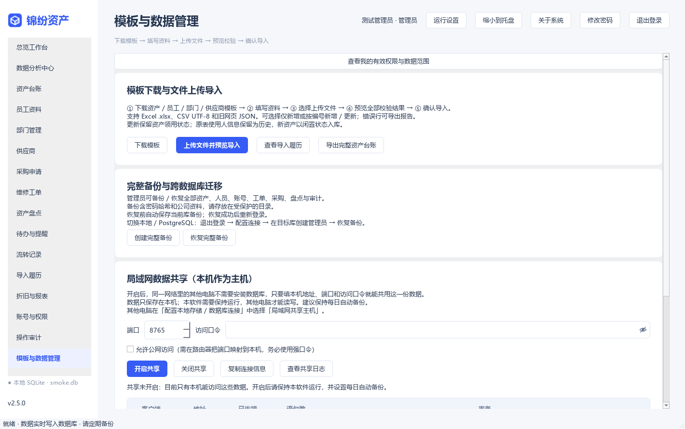

<div align="center">

# 锦纷资产管理系统

**让每一项资产都有清晰的去向**

面向公司、团队和机构的 Windows 桌面资产管理工具

    

[下载最新版](../../releases/latest) · [功能总览](#-功能总览) · [快速上手](#-快速上手) · [从源码运行](#-从源码运行) · [常见问题](#-常见问题)

</div>

---

## 📷 界面预览

| 总览工作台 | 资产台账 |
| :---: | :---: |
|  |  |

| 数据分析中心 | 模板与数据管理 |
| :---: | :---: |
|  |  |

## ✨ 简介

锦纷资产管理系统是一款**原生桌面**（非浏览器套壳）的资产管理软件，整合台账管理、员工部门、领用归还、调拨、维修、采购审批、盘点、折旧统计和操作审计，开箱即用、无需安装数据库服务。

- 🖥️ **原生 Qt 桌面界面**：基于 PySide6（Qt 6）构建，单文件 EXE 即可运行
- 💾 **三种数据模式**：SQLite 本地单机 / 内置局域网共享（免装数据库）/ PostgreSQL 集中共享
- 📊 **完整业务闭环**：从采购申请审批到报废归档的全生命周期管理
- 🔐 **内建权限体系**：43 项细粒度权限、角色矩阵、数据范围隔离、全程操作审计
- 📦 **数据自持**：所有数据保存在本机或自建数据库，不经任何第三方云服务

## 🚀 快速上手

### 下载安装

前往 [Releases 页面](../../releases/latest) 下载以下任一版本：

| 文件 | 说明 |
| :--- | :--- |
| `锦纷资产管理系统-安装版-2.5.0.exe` | 安装版：创建开始菜单入口，可选桌面快捷方式，内置卸载器 |
| `锦纷资产管理系统.exe` | 便携版：单文件免安装，解压即用 |

> 系统要求：Windows 10 / 11，64 位。软件暂未进行代码签名，首次运行如遇 SmartScreen 提示，选择「仍要运行」即可；下载后请核对 Release 附带的 SHA256 校验值。

### 首次登录

1. 双击 EXE 打开登录页，用户名已自动填好 `owner`。
2. 输入发行方提供的**内置管理员口令**进入系统。
   - 软件内置一个出厂固定的管理员账号（用户名 `owner`），口令校验值在编译时写死——软件发给谁、装在哪台电脑，这个账号都一致；
   - 明文口令不随软件分发。自用部署请在首次登录后妥善保管口令（详见 `使用说明.txt` 第二节）；
   - 该账号的口令、角色与启用状态**不能在软件内修改**，也不能被停用或删除；若数据库中的账号记录被篡改（改口令、降级、停用、试错锁定），下次登录会自动恢复出厂设置并写入审计。
3. 为同事开通账号：登录后切换到「注册」选项卡。**新注册账号一律为只读用户**且立即可登录；管理员身份只能由内置管理员在「账号与权限」中授予。
4. 建议按顺序初始化：**部门 → 员工 → 供应商 → 资产**。

### 常用快捷键

`Ctrl+F` 搜索 · `F5` 刷新 · `Ctrl+E` 导出 · `Ctrl+N` 新增资产

## 🧩 功能总览

<details open>
<summary><b>业务模块（点击折叠）</b></summary>

| 模块 | 能力 |
| :--- | :--- |
| **总览工作台** | 资产数量与状态统计、类别分布、原值净值、采购待办、逾期未还与保修提醒 |
| **资产台账** | 新增 / 编辑 / 搜索 / 状态与类别筛选、序列号、位置、购入与保修信息、图片拖拽上传 |
| **资产流转** | 领用、归还、员工调拨、位置移动、送修、维修完成、报废 |
| **使用历史** | 每次变化记录操作账号、时间与原文，不限制追加条数 |
| **员工部门** | 员工编号、部门、联系方式、在职状态；在用资产未归还前禁止停用员工 |
| **供应商** | 编号、名称、联系人、电话、备注 |
| **维修工单** | 送修生成工单，完工登记结果与实际费用，保留起止时间 |
| **采购申请** | 提交预算与理由 → 另一名管理员审批 → 批准后入库；禁止申请人自审 |
| **资产盘点** | 按全部资产或位置建立快照，登记实盘数与差异说明，关闭后可导出明细 |
| **折旧报表** | 直线法完整月折旧计算，Excel / CSV 导出，打印与 PDF 输出 |
| **资产标签** | 生成二维码 PNG，打印标签或保存 PDF |
| **导入导出** | Excel / CSV / 旧网页 JSON 导入；模板下载、预览校验、错误行报告、导入履历 |
| **待办提醒** | 逾期未还、保修到期、待审批采购集中提示 |
| **操作审计** | 登录、资料修改、资产流转、采购、盘点、备份恢复全部留痕 |

</details>

<details open>
<summary><b>数据存储三种模式</b></summary>

| 模式 | 适用场景 | 说明 |
| :--- | :--- | :--- |
| **SQLite 本地**（默认） | 单机单人 | 数据保存在本机用户目录，零配置 |
| **局域网共享** | 5～30 人小团队 | 一台电脑作主机自建共享服务，其他电脑填地址、端口、访问口令即可共用数据，**无需安装任何数据库**；支持访问口令、公网访问开关、在线客户端查看与连接日志 |
| **PostgreSQL** | 中大型团队 | 连接集中数据库，跨机器实时共享，权限在应用业务层生效 |

</details>

<details>
<summary><b>安全设计</b></summary>

- 密码使用 **PBKDF2-SHA256** 哈希存储，连续输错 5 次锁定 15 分钟
- 43 项细粒度权限 + 角色矩阵 + 数据范围隔离，修改权限在业务层二次复查
- 局域网共享服务：HMAC-SHA256 挑战应答认证（口令不明文传输）、SQL 语句白名单（仅放行单条参数化 SELECT / INSERT / UPDATE / DELETE）、同地址连错 5 次暂停 10 分钟
- 数据库连接口令使用 **Windows DPAPI** 加密，绑定当前 Windows 账户
- 全部业务操作写入审计日志

</details>

## 💻 从源码运行

```bash
# 1. 克隆仓库
git clone https://github.com/jingpanlong/jinfen-asset-management.git
cd jinfen-asset-management

# 2. 安装依赖（建议 Python 3.11 虚拟环境）
pip install -r source/requirements.txt

# 3. 运行
python source/app.py
```

### 运行测试

```bash
cd source
python -m unittest test_system test_enhanced test_analytics test_desktop test_access test_photos test_ui_cursor test_crud test_password_field test_table_style test_share test_owner -v
```

当前共 **162 项单元测试**全部通过（含 44 项局域网共享测试、14 项内置账号测试）。

### 打包发行

```powershell
# 单文件 EXE（PyInstaller）
cd source
python -m PyInstaller --noconfirm --clean --distpath ../portable/2.5.0 --workpath build JinfenAssets.spec

# 安装包（Inno Setup 6）
ISCC.exe installer.iss
```

## 📁 项目结构

```
jinfen-asset-management/
├── source/                # 全部源码
│   ├── app.py             # 主程序与界面
│   ├── service.py         # 业务服务层
│   ├── access.py          # 权限与账号体系（含内置管理员）
│   ├── database.py        # 数据库引擎（SQLite / PostgreSQL / 远程）
│   ├── share_protocol.py  # 局域网共享协议（分帧 + 白名单 + 挑战应答）
│   ├── share_server.py    # 主机端共享服务
│   ├── share_client.py    # 客户端远程数据库
│   ├── analytics.py       # 数据分析
│   ├── enhanced.py        # 增强业务逻辑
│   ├── test_*.py          # 162 项单元测试
│   └── JinfenAssets.spec  # PyInstaller 打包配置
├── docs/screenshots/      # 界面截图
├── licenses/              # 第三方组件许可声明
├── 使用说明.txt            # 完整使用文档（随安装包分发）
├── 2.x*使用说明.txt        # 各版本功能专项说明
└── 验证报告-2.5.0.txt      # 发布验证报告
```

## ❓ 常见问题

<details>
<summary><b>数据保存在哪里？如何迁移到新电脑？</b></summary>

默认数据目录：`%LOCALAPPDATA%\QiyunAssets\`（含 SQLite 数据库、配置与自动备份）。数据按 **Windows 账户**定位，不随安装目录走；同一台电脑同一 Windows 账户的安装版与便携版共用同一份数据。

跨电脑迁移请使用软件内「创建完整备份」导出 JSON，在新电脑上「恢复完整备份」。**不要**直接拷贝 SQLite 数据库文件到网络共享目录——SQLite 的 WAL 模式不支持网络文件系统，会静默损坏数据。

</details>

<details>
<summary><b>局域网共享需要开放什么端口？</b></summary>

主机端默认监听 **TCP 8765**（可在共享设置中修改），首次启用时 Windows 防火墙会提示放行。勾选「允许公网访问」后需在路由器做端口映射（软件不含内网穿透），且口令强制不少于 12 位。

</details>

<details>
<summary><b>内置管理员口令忘记了怎么办？</b></summary>

软件内无法找回或重置（这是安全设计：口令校验值编译时写死，任何人拿到软件都改不了这个账号）。请通过完整备份中的记录或向发行方索取。因此**首次部署后请立即妥善保管口令**。

</details>

<details>
<summary><b>为什么新注册的账号什么都不能改？</b></summary>

这是刻意的默认策略：自行注册的账号一律为**只读用户**（能看不能改），防止来历不明的账号获得数据写入能力。管理员身份只能由内置管理员账号（`owner`）在「账号与权限」中授予，其他管理员无法提升管理员、无法动内置账号。

</details>

## 🗺️ 版本历史

<details>
<summary><b>v2.5.0（当前版本）</b></summary>

- 🔴 出厂固定内置管理员账号：口令编译期写死、软件内不可修改、被篡改自动恢复
- 🌐 局域网数据共享：主机一键开共享，客户端免装数据库，支持公网访问开关
- 🔒 共享协议四层安全：网络层 / 认证层 / SQL 白名单层 / 防爆破
- 🖼️ 界面布局修复：数据管理页面窄窗口滚动条替代控件压缩
- 📋 权限体系扩展至 43 项；单元测试扩展至 162 项

</details>

<details>
<summary><b>历史版本</b></summary>

- v2.4：高级权限体系（43 项权限、角色矩阵、数据范围、审计）
- v2.3：开机自启与系统托盘
- v2.2：高级可视化（数据分析中心、图表）
- v2.1：批量操作、待办提醒、增删改查强化
- v2.0：资产图片、详情页、附件管理
- v1.x：资产台账、领用归还、维修、采购、盘点、折旧基础功能

</details>

## 📄 许可证

本项目基于 [MIT License](LICENSE) 开源。第三方组件的许可声明见 [licenses/](licenses/) 目录（Qt / PySide6 为 LGPL-3.0，Python 为 PSF License，其余组件遵循各自许可证）。

## 📮 联系方式

| 平台 | 账号 |
| :--- | :--- |
| 微信公众号 | 景同志 |
| 小红书 | 景同学 |

欢迎通过上述平台反馈问题、提出建议或了解系统动态。提交 Issue 前请先阅读文档与常见问题；欢迎 Star ⭐ 与 Fork。

---

<div align="center">

**如果这个项目对您有帮助，请给个 Star 支持一下 ⭐**

</div>
